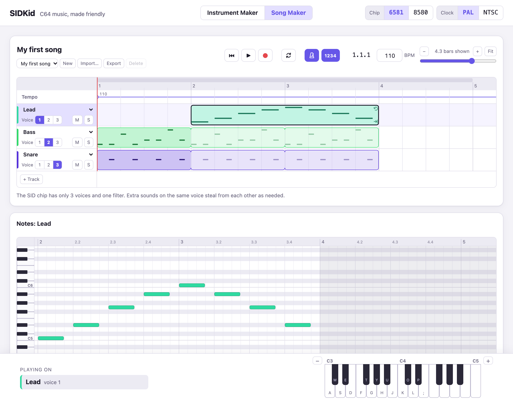

# SIDKid

Make Commodore 64 music in the browser. SIDKid is a friendly way into the
SID chip, built on the GoatTracker 2 engine by Lasse Öörni (Cadaver): shape
sounds on a timeline, arrange them as tracks and clips, and take the result
to a real C64.

**Try it: [needlestack.github.io/sidkid](https://needlestack.github.io/sidkid/)**



- **Instrument Maker**: draw a sound over time: volume envelope, waveforms
  and pulse width, pitch steps and vibrato, filter sweeps.
- **Song Maker**: tracks of clips on the SID's three voices, a piano roll,
  recording from the computer keyboard, tempo changes, slides and vibrato
  on notes.
- **Export** as a C64 disk (`.d64`) that loads and plays by itself (drop
  it on VICE), a SID file, a GoatTracker song, or a WAV. **Import**
  GoatTracker songs.
- What you hear is GoatTracker's own player on reSID, so a song plays the
  same in SIDKid, in GoatTracker and on the C64.

New here? Read the **[quick start](docs/quickstart.md)**.

## Running it locally

```sh
cd engine
make wasm     # build/wasm/sidkid.js + sidkid.wasm (needs Emscripten)
cd ../web
npm install
npm run dev   # http://localhost:5173
```

## Tests

```sh
cd engine && make test   # native vs. GoatTracker's own sources vs. wasm, every example song
cd web && npm test       # headless Chrome: the AudioWorklet against the native engine, and the two pages
cd web && npm run c64check   # optional, needs VICE: exported disks booted on PAL and NTSC C64s
```

`make test` requires the native, reference and wasm builds to write the same
SID registers every frame and the same audio samples. `npm test` drives both
pages in Chrome. `node scripts/screenshots.mjs` takes the screenshots in
`docs/` again.

## Layout

- `vendor/gt2/`: GoatTracker 2.77, untouched, for reference and testing.
- `engine/core/`: GoatTracker's song model, player, packer/relocator (with
  its assembler and `player.s`) and reSID. `goattrk2.h`, `gglue.c` and
  `gpack.c` stand in for the editor; reSID's `wave.cpp` is changed so the
  noise survives a short test bit, as on the chip.
- `engine/sidkid.[ch]`: the engine's API (play songs, scan them, play and
  trace single notes, sequence notes from outside, pack songs for the C64).
  `engine/tools/` has the native test tools.
- `web/`: the app (Vite and TypeScript). The engine runs in an
  AudioWorklet (`src/engine/`). `instruments2.html` and `src/maker2.ts` are
  the Instrument Maker; `songs.html` and `src/songmaker.ts` the Song Maker,
  with the song model in `src/songdoc.ts`, GoatTracker import and export
  in `src/songimport.ts` and `src/songexport.ts`, and the C64 disk in
  `src/c64export.ts`.
- `NOTES.md`: working notes, for picking the work up again.

## Deployment

`.github/workflows/deploy.yml` builds the engine with Emscripten, runs the
engine and browser tests, and publishes the site to GitHub Pages on every
push to `main`.

## License

GPL v2, as GoatTracker (see `LICENSE`). It includes:

- GoatTracker 2 and reSID (GPL v2);
- GoatTracker's assembler by Magnus Lind (`engine/core/asm/`), free for
  non-commercial, non-profit use (see its file headers);
- d64lib from GMC64 (`web/src/d64lib.js`, MIT).
