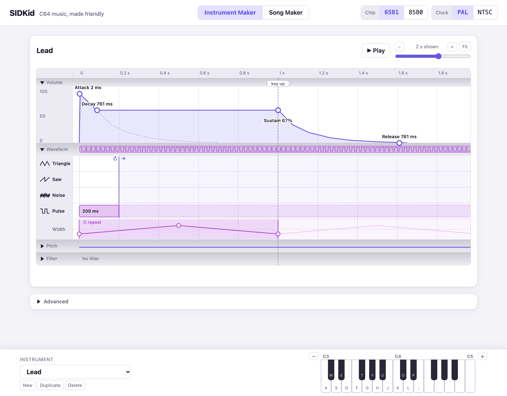
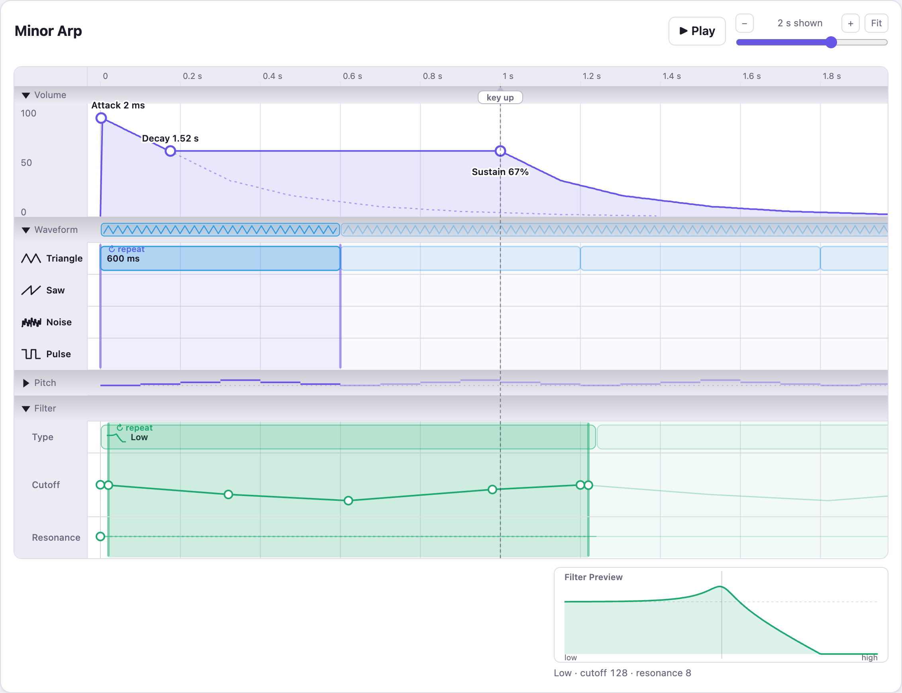
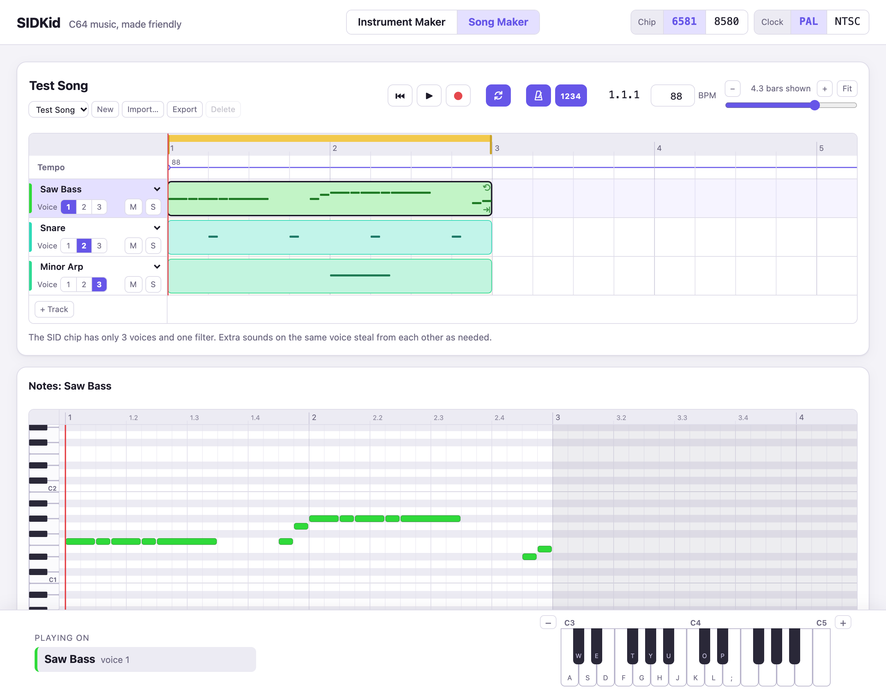
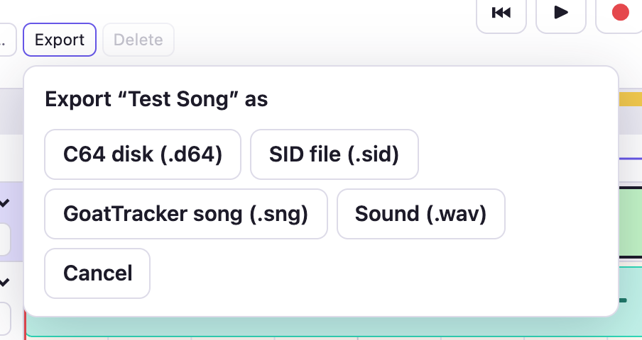

# SIDKid quick start

SIDKid has two pages, switched in the middle of the top bar: the
**Instrument Maker** for sounds and the **Song Maker** for arranging them.
At the right of the top bar, pick the chip (6581 or 8580) and the clock
(PAL or NTSC). They apply everywhere, and your work is kept in the browser
as you go.

Both pages play from the computer keyboard: the row from A to ; is the
white keys, W E T Y U O P the black keys. The − and + by the keyboard
move the octave (`,` and `.` do too, in the Song Maker).

## Instrument Maker

A sound is a timeline, from key down on the left. Pick an instrument
(or New, or Duplicate) at the bottom left. Space plays it while you hold it.

- **Volume**: drag the attack, decay, sustain and release handles. The
  dashed *key up* line is where ▶ Play lets go.
- **Waveform**: drag along a row to draw a bar of that waveform; bars
  follow each other in time, so a sound can start as a pulse and turn into
  a saw. At the end of the last bar, drag ↻ left to repeat part of it while
  the key is held; → chooses between holding the last waveform and falling
  silent. With a pulse, the **Width** row sets its pulse width: click to
  add a point, drag to move one, and ↻ repeats it the same way.
- **Pitch**: steps in semitones from the note played, drawn like the
  waveform bars (arpeggios, a drum's falling pitch). Drag along the
  **Vibrato** row to add vibrato from that point.
- **Filter**: drag along the **Type** row to filter a stretch of the sound
  (low, band or high pass, which combine), then shape its **Cutoff** and
  **Resonance** lines. The filter stays on after its last stretch.

Click a section's name to fold it; folded, it shows a summary. Select
anything and press Delete to remove it; ⌘Z undoes. **Advanced** holds
GoatTracker's note-start settings, which rarely need changing.

## Song Maker

A song is tracks of clips, as in GarageBand. Each track plays one
instrument on one of the SID's three voices (1 2 3). Tracks can share a
voice, and a note takes the voice when it starts. M mutes a track, S solos
it, + Track adds one.

- **Clips**: double-click in a track to add one. Drag to move it
  (⌥-drag copies), drag its lower right corner for its length and its upper
  right corner to repeat it. ⌘D duplicates.
- **Notes**: click a clip to open it in the editor below. Double-click
  to add a note, drag to move it or change its length, drag across empty
  space to select several. ⌘C and ⌘V copy notes to the playhead. Over a
  selected note, the buttons slide into it or add vibrato.
- **Playing**: Space plays and stops, Z goes back to the start, C repeats
  the yellow stretch of the ruler (drag along the top of the ruler to set
  it), M is the metronome. R records what you play on the selected track.
- **Tempo**: type the BPM. Double-click the Tempo row to change it
  part-way through a song.

## Import and export

**Import…** brings in GoatTracker songs: one of the examples, or a `.sng`
file of your own. Their instruments join the Instrument Maker's.

**Export** makes:

- **C64 disk (.d64)**: drop it on VICE (or load it on a C64 with
  `LOAD"*",8,1` and `RUN`) and it plays. It runs at the song's own
  speed on PAL and NTSC machines alike.
- **SID file (.sid)**: for SID players.
- **GoatTracker song (.sng)**: also how to keep or move a song. It
  carries the whole SIDKid song, so importing it gives the song back exactly
  as you made it. GoatTracker opens it too and plays it the same way, when
  set to the same chip and clock; once saved from GoatTracker, it comes back
  as a GoatTracker song.
- **Sound (.wav)**.
